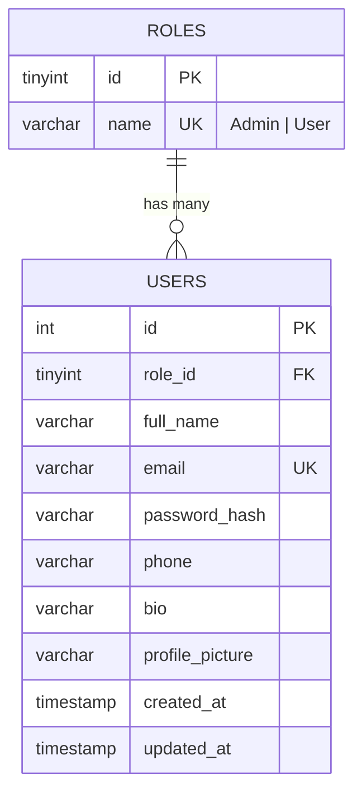

# ER Diagram & Normalization

## ER Diagram (Mermaid - renders on GitHub)

One role can be assigned to many users; each user has exactly one role.

## Normalization

**1NF** - Every column holds a single atomic value (no repeating groups or comma-separated lists), each row is uniquely identified by a primary key (`id`).

**2NF** - Both tables use a single-column primary key, so no non-key attribute can depend on only part of a key. Every column in `users` depends on the whole `users.id`.

**3NF** - No transitive dependencies. The role name does not live in `users` (that would make `role_name` depend on `role_id` rather than on `id`); it is stored once in `roles` and referenced by the foreign key `users.role_id`. Renaming a role is therefore a single-row update.
